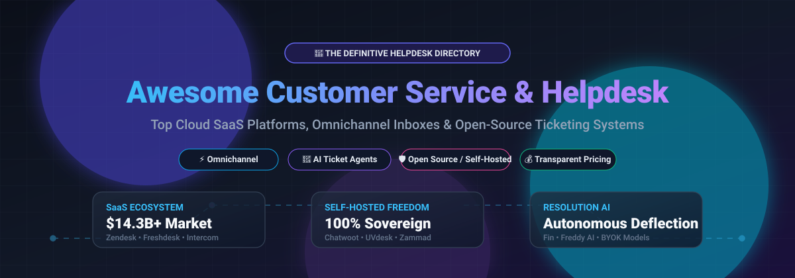

  

# Awesome Customer Service & Helpdesk Software

  
  
  
  

> 🚀 A comprehensive, community-curated directory of the finest **Customer Service Software**, **Enterprise Helpdesk Platforms**, **Ticketing Systems**, and **Collaborative Shared Inboxes** — comparing leading cloud SaaS solutions, AI resolution agents, and self-hosted open-source alternatives.

---

## 📑 Table of Contents

- [📌 Overview & Ecosystem](#-overview--ecosystem)
- [📊 Sector Overview & Market Dynamics](#-sector-overview--market-dynamics)
- [☁️ SaaS & Hosted Helpdesk Platforms](#️-saas--hosted-helpdesk-platforms)
  - [SaaS Solutions Comparison Matrix](#saas-solutions-comparison-matrix)
- [🛠️ Open-Source & Self-Hosted Ticketing Systems](#️-open-source--self-hosted-ticketing-systems)
  - [Open-Source Solutions Comparison](#open-source-solutions-comparison)
  - [Self-Hosted Architecture & TCO Guide](#self-hosted-architecture--tco-guide)
- [⚖️ How to Choose: SaaS vs. Open Source](#️-how-to-choose-saas-vs-open-source)
- [📈 Star History](#-star-history)
- [🤝 Contributing](#-contributing)
- [☕ Support](#-support)
- [⚖️ License & Disclaimer](#️-license--disclaimer)

---

## 📌 Overview & Ecosystem

Managing modern customer support workflows requires scalable tools for multi-channel communication, automated routing, SLA enforcement, customer satisfaction (CSAT) tracking, and self-service knowledge bases. 

Whether you are looking for an **omnichannel enterprise SaaS helpdesk** (such as Zendesk, Freshdesk, or Intercom) or evaluating **self-hosted open-source ticketing software** (such as Chatwoot, UVdesk, Zammad, or FreeScout) for complete data sovereignty and zero seat-licensing fees, this directory provides detailed feature breakdowns, exact starting prices, company valuations, and free tier limitations.

### 🎯 Key Evaluation Criteria
* 🌐 **Omnichannel Support:** Unified management across email, live chat, voice/phone, WhatsApp, and social media.
* 🤖 **Automation & AI Resolution:** AI agent deflection, automated ticket routing, SLA triggers, and canned macros.
* 🛡️ **Data Sovereignty & Self-Hosting:** Open-source alternatives with zero per-seat licensing fees for privacy and compliance (GDPR, HIPAA).
* 💳 **Cost Predictability:** Seat-based vs. consumption/AI outcome-based pricing models.

---

## 📊 Sector Overview & Market Dynamics

The global customer service and helpdesk software sector is estimated at **$12.0B to $14.3B in 2025–2026** (expanding to over **$55B+** when factoring in the broader customer experience and CRM ecosystem), compounding at an annual growth rate of ~8–9%. 

The sector exhibits **moderate fragmentation**: top-tier enterprise conglomerates (such as ServiceNow, Atlassian, Zendesk, and Freshworks) control high-ACV enterprise IT and CRM service desks, while a vibrant and intensely competitive long tail of mid-market SaaS tools (Intercom, Front, Help Scout, Gorgias) and self-hosted open-source alternatives (Chatwoot, UVdesk, Zammad) serve agile startups, e-commerce stores, and privacy-conscious organizations.

---

## ☁️ SaaS & Hosted Helpdesk Platforms

Enterprise and cloud-hosted helpdesk solutions providing turnkey infrastructure, continuous updates, native AI copilot capabilities, and hundreds of CRM integrations.

### SaaS Solutions Comparison Matrix

*The table below is sorted descending by company scale (market capitalization / valuation).*

| Product | Company Scale (Valuation / Market Cap) | Category & Key Features | Starting Tier Pricing | Free Tier / Trial Limits |
|:---|:---:|:---|:---|:---|
| **[ServiceNow CSM](https://www.servicenow.com/)** | **~$200B+** (Market Cap) | Enterprise-grade customer service management platform with case routing, omnichannel workflows, and Now Assist AI. | Standard: **$130/fulfiller/month** (annual contract required) | **No Free Tier / No Self-Serve Trial**. Guided enterprise demo and sales-provisioned PoC sandbox available upon request. |
| **[Jira Service Management](https://www.atlassian.com/software/jira/service-management)** | **~$45B+** (Atlassian Market Cap) | IT Service Management (ITSM) and customer service platform built on Atlassian with Rovo AI, incident workflows, and SLA automation. | Standard: **$17.65/agent/month** (annual); Premium: $44.30/agent/month | **Permanent Free Tier**: Up to 3 agents, unlimited customer requesters, 2 GB file storage, and 100 emails/day. |
| **[Zendesk Support](https://www.zendesk.com/)** | **~$10.2B** (Acquisition Valuation) | Industry-standard ticketing system with comprehensive REST APIs, trigger automations, and Outcome AI Platform transition. | Support Team: **$19/agent/month** (billed annually) | **14-day free trial** (access to full Suite Team/Growth capabilities, no credit card required); no permanent free plan. |
| **[Zoho Desk](https://www.zoho.com/desk/)** | **~$5B+** (Zoho Corp Valuation) | Context-aware cloud helpdesk within Zoho suite featuring email ticketing, social integration, SLAs, and Zia AI. | Express: **$7/agent/month**; Standard: $14/agent/month (annual) | **Permanent Free Tier**: Up to 3 agents, basic email ticketing, and customer portal. **15-day free trial** with auto-downgrade to Free. |
| **[Intercom](https://www.intercom.com/)** | **~$3.9B** (Valuation) | AI-first customer service platform featuring autonomous Fin AI agent, agent copilot, and proactive messenger. | Essential: **$29/seat/month** (billed annually) | **14-day free trial** of Essential/Advanced plans (no credit card required); no permanent free tier. Fin AI incurs $0.99/resolution. |
| **[Freshdesk](https://www.freshworks.com/freshdesk/)** | **~$3.8B** (Freshworks Market Cap) | Omnichannel cloud helpdesk with Freddy AI agent, custom dashboards, round-robin assignment, and skill routing. | Growth: **$19/agent/month** (billed annually) | **14-day free trial** of Pro plan (no credit card required); Freddy AI includes 500 free sessions during trial; no permanent free tier. |
| **[Front](https://front.com/)** | **~$1.7B** (Valuation) | Collaborative shared inbox uniting customer email, SMS, chat, and internal mentions with SLA management. | Starter: **$25/seat/month** (annual billing) | **14-day free trial** of Professional tier (no credit card required); no permanent free plan. |
| **[Gorgias](https://www.gorgias.com/)** | **~$710M** (Valuation) | E-commerce helpdesk with deep Shopify, BigCommerce, and Magento integrations and automated order actions. | Starter: **$10/month** (includes up to 3 seats and 50 tickets/month; overage: $0.40/ticket) | **7-day free trial** with full access to Starter/Basic features (no credit card required); no permanent free plan. |
| **[Help Scout](https://www.helpscout.com/)** | **~$100M+** (Est. Valuation) | Human-centric shared inbox and knowledge base platform with AI Drafts and collaborative collision detection. | Standard: **$25/user/month** (billed annually); Docs KB is +$10/user/mo | **Permanent Free Tier**: Up to 5 users, 1 Shared Inbox, and 1 Docs site. Paid tiers include a **15-day free trial**. |
| **[LiveAgent](https://www.liveagent.com/)** | **~$50M+** (Est. Valuation) | Helpdesk with universal inbox, real-time live chat widget, call center capabilities, and BYO-AI provider key. | Small: **$9/agent/month** (billed annually); Medium: $29; Large: $49 | **14-day free trial** (extendable up to 30 days upon request, no credit card required); no permanent free tier. |

---

## 🛠️ Open-Source & Self-Hosted Ticketing Systems

Self-hosted ticketing software and shared inboxes ideal for engineering teams, privacy-conscious businesses, educational institutions, and organizations seeking full data sovereignty with zero per-agent costs.

### Open-Source Solutions Comparison

*The table below is sorted descending by GitHub stargazers count.*

| Project | Star Count Badge | Primary Tech Stack | License | Highlights & Architecture |
|:---|:---:|:---:|:---:|:---|
| **[Chatwoot](https://github.com/chatwoot/chatwoot)** |  | Ruby on Rails, Vue.js, PostgreSQL | AGPL-3.0 | **Top open-source alternative to Intercom & Zendesk.** Modern omnichannel customer engagement suite with live chat, email, WhatsApp, Facebook, Instagram, and Telegram intake. Clean agent dashboard and mobile apps. |
| **[UVdesk](https://github.com/uvdesk/community-skeleton)** |  | PHP, Symfony, MySQL | MIT | **Customer portal & eCommerce helpdesk.** Community skeleton focusing on ticket management, multi-agent dispatch, customer self-service portals, and modular eCommerce connectors (Magento, WooCommerce, Shopify). |
| **[GLPI](https://github.com/glpi-project/glpi)** |  | PHP, MariaDB / MySQL | GPL-3.0 | **Best combined IT Asset Management (ITAM) and Service Desk.** Designed for ITIL-compliant service management, ticket routing, hardware/software inventory auditing, and data center asset tracking. |
| **[Papercups](https://github.com/papercups-io/papercups)** |  | Elixir, Phoenix, React, PostgreSQL | MIT | **Lightweight developer-first live chat & inbox.** Built on Elixir and Phoenix channels for high-concurrency real-time customer messaging. Easily embeddable chat widget with Slack integration. |
| **[Zammad](https://github.com/zammad/zammad)** |  | Ruby on Rails, PostgreSQL, Elasticsearch | AGPL-3.0 | **Feature-complete Zendesk alternative.** Features native 1-click data importers for Zendesk, Freshdesk, Kayako, and OTRS. Omnichannel intake (email, chat, phone, social), granular role permissions, and REST APIs. *(Requires 4–8 GB RAM for Elasticsearch)*. |
| **[FreeScout](https://github.com/freescout-helpdesk/freescout)** |  | PHP, Laravel, MySQL | AGPL-3.0 | **Best open-source Help Scout alternative.** Ultra-lightweight shared mailbox and helpdesk built with PHP/Laravel. Optimized to run smoothly on minimal hardware (1–2 GB RAM or low-cost cPanel hosting). Modular ecosystem for SLA and custom fields. |
| **[erxes](https://github.com/erxes/erxes)** |  | TypeScript, Node.js, React, MongoDB | AGPL-3.0 | **Open-source Experience Operating System (XOS).** All-in-one suite combining customer support helpdesk, shared inbox, CRM, marketing automations, and sales pipelines to replace HubSpot and Zendesk. |
| **[osTicket](https://github.com/osTicket/osTicket)** |  | PHP, MySQL | GPL-2.0 | **Classic battle-tested email ticketing engine.** Straightforward and highly stable email-to-ticket conversion with custom form fields, auto-responder rules, and client web portal without complex dependencies. |
| **[Chaskiq](https://github.com/chaskiq/chaskiq)** |  | Ruby on Rails, React, PostgreSQL | AGPL-3.0 | **Conversational marketing & support messaging.** Open-source platform competing directly with Intercom and Drift. Features automated conversational bot builders, in-app messaging, email newsletters, and CRM sync. |
| **[Helpy](https://github.com/helpyio/helpy)** |  | Ruby on Rails, PostgreSQL | MIT | **Mobile-friendly helpdesk and knowledge base.** Features customer discussion forums, public knowledge base, and email ticketing with multilingual localization. |
| **[Faveo Helpdesk](https://github.com/ladybirdweb/faveo-helpdesk)** |  | PHP, Laravel, MySQL | Proprietary / Community | **Laravel-based multi-tier ticketing system.** Built-in knowledge base, customer portal, SLA escalation workflows, and ticket assignment rules. |

### Self-Hosted Architecture & TCO Guide

When evaluating the **Total Cost of Ownership (TCO)** of self-hosting vs. cloud SaaS:

* 🖥️ **Server Infrastructure Costs:**
  * **Minimal Footprint (FreeScout, osTicket):** 1 vCPU, 1–2 GB RAM (~$5–$10/month on Hetzner, DigitalOcean, or AWS Lightsail).
  * **Moderate Footprint (Chatwoot, GLPI, Helpy):** 2 vCPUs, 2–4 GB RAM with Redis & Postgres (~$15–$25/month).
  * **Heavy / Full-Text Indexing (Zammad, erxes):** 2–4 vCPUs, 4–8+ GB RAM (Elasticsearch memory requirements) (~$30–$60/month).
* 🔒 **Maintenance & Compliance:** Self-hosting grants total control over customer data, HIPAA/GDPR isolation, and on-premises hosting, but demands team allocation for database backups, SSL certificates, SMTP delivery reputation, and security patching.
* 🧩 **Extensibility & Plugins:** Platforms like FreeScout and UVdesk feature modular add-on marketplaces (e.g., custom integrations, SLA managers, CSAT modules).

---

## ⚖️ How to Choose: SaaS vs. Open Source

| Dimension | Cloud SaaS (Zendesk, Freshdesk, Intercom) | Self-Hosted Open Source (Chatwoot, UVdesk, Zammad) |
|:---|:---|:---|
| ⏱️ **Deployment Speed** | Instant onboarding (minutes) | Requires VM setup, Docker configuration, and DNS/mail setup |
| 🛡️ **Data Privacy & Control** | Data stored on vendor servers | 100% data sovereignty within your own VPC/servers |
| 💰 **Pricing Model** | Recurring per-agent seats + AI resolution outcome fees | Fixed VPS server costs; unlimited agents & unlimited tickets |
| 🔧 **Maintenance Overhead** | Zero server maintenance; vendor updates | Regular OS updates, automated DB backups, uptime monitoring |
| 🤖 **AI Capabilities** | Proprietary AI (Fin, Freddy AI, Zia) with usage fees | Bring-your-own-API-key (OpenAI/Anthropic) or local LLM pipelines |

---

## 📈 Star History

---

## 🤝 Contributing

Contributions, product additions, pricing revisions, and new open-source helpdesk submissions are warmly welcomed!

1. 🍴 **Fork** the repository.
2. 🌿 **Create a branch**: `git checkout -b feature/add-new-helpdesk`
3. ✍️ **Commit your changes**: Ensure you include product name, official link, pricing/license details, and descriptions.
4. 🚀 **Push to your branch**: `git push origin feature/add-new-helpdesk`
5. 📬 **Open a Pull Request** with a concise description of your additions.

---

## ☕ Support

If you find this curated directory helpful for evaluating customer support infrastructure:
* ⭐ **Star** this repository on GitHub.
* 🍴 **Fork** and share it with your fellow support and DevOps engineers.
* 💖 **Sponsor / Buy a coffee**: If you'd like to support the ongoing maintenance of this and other curated lists, please visit the [GitHub Sponsor Dashboard](https://github.com/sponsors/ishandutta2007). Thank you for your generosity!

---

## ⚖️ License & Disclaimer

* This repository is a community-curated educational resource and directory. All product names, logos, and brands are property of their respective owners.
* Pricing structures, trial limits, and feature tiers change over time; always confirm latest details on official vendor pricing pages before making purchasing decisions.
